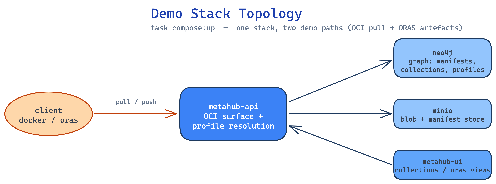

# MetaHub

MetaHub is a container image registry that takes the **context of a user**
into account to deliver the best-suited container image. It sits in front of an
OCI registry and computes profile-aware image indexes from a graph of
manifests, collections, rules and profiles.

This site documents the **conference demo**: a runnable, scripted tour of three
capabilities.

-   :material-image-multiple: **[Small Images](small-images.md)**

    A curated, reproducible set of demo images (the "glow" layers and
    multi-arch alpine) seeded into the stack.

-   :material-layers-edit: **[Manipulations](manipulations.md)**

    How MetaHub rewrites image layers per profile — defaults and variants.

-   :material-package-variant-closed: **[ORAS Artefacts](oras-artefacts.md)**

    Pushing and discovering OCI artefacts (referrers) with `oras`.

-   :material-play-circle: **[Walkthrough](walkthrough.md)**

    The end-to-end live demo script, tying the UI views to the registry.

## The demo stack

The demo runs on the docker-compose stack (`task compose:up`):

- **neo4j** — the graph that stores manifests, collections, rules, profiles.
- **minio** — blob and manifest storage.
- **metahub-api** — the OCI-compatible registry surface + profile resolution.
- **metahub-ui** — the React frontend (collections, profiles, ORAS views).

Images are seeded from public glow layers and multi-arch alpine, then the graph
computes manifests and manifest lists. The **OCI demo** exercises the
registry/pull path; the **ORAS demo** exercises the artefact/referrers path.
Both run against the same seeded stack.

!!! note "Reusing these pages"
    Every page on this site is plain Markdown under `docs/`. The same files are
    consumed by **qshuf** to build the slide deck — keep prose and diagrams
    portable (no site-specific shortcodes beyond standard Markdown + admonitions).
