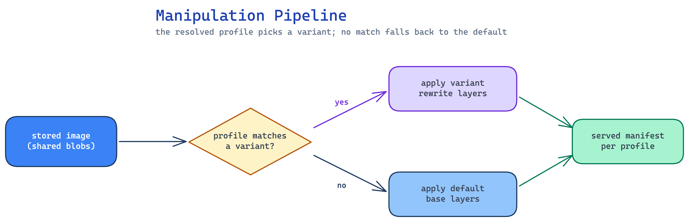

# Manipulations

A **manipulation** rewrites an image before it is served, based on the resolved
**profile**. Unlike the microarchitecture selection (which only *picks* an
existing manifest — see [Small Images](small-images.md)), a manipulation
*changes* the image: it can overlay extra **layers** and mutate the OCI
**config** (entrypoint, cmd, env, …). This is how MetaHub turns one stored
image into a purpose-built variant for a given user context.

## Two kinds of change

| Change | Example |
|---|---|
| **Layer overlay** | append extra filesystem layers on top of the base image |
| **Config mutation** | rewrite `Entrypoint` / `Cmd` / `Env` / `WorkingDir` / … |

The stored blobs are shared; only the manifest (and the small new layers) the
client receives differ per profile.

## Example: the `glow-extended` profile

The `glow-extended#1.5.0` profile overlays a help/“glow” layer set onto
`qnib/ftest` **and** rewrites the entrypoint so the container renders a help
page before running its real program.

First, for reference, pull with a plain microarchitecture profile — no
manipulation, just the base image:

```console
$ echo oci | docker login --password-stdin -u 'oci/cpu#zen3' metahub-registry.org
Login Succeeded

$ docker pull --platform=linux/amd64 metahub-registry.org/qnib/ftest:latest
$ docker inspect metahub-registry.org/qnib/ftest:latest
```
```json
"Config": {
    "Env": [ "...", "ORG_SUPERCONTAINERS_HARDWARE_CPU_TARGET_MICROARCH=zen3" ],
    "Cmd": [ "/usr/bin/entry.sh" ],
    "WorkingDir": "/"
},
"RootFS": {
    "Layers": [
        "sha256:8d78b2117a5b...",   // base layer
        "sha256:7b386a2af9d0..."    // base layer
    ]
}
```

No `Entrypoint`, **2 layers** — this is the unmanipulated image.

Now pull the same tag with the `glow-extended` profile:

```console
$ echo oci | docker login --password-stdin -u 'oci/glow-extended#1.5.0' metahub-registry.org
Login Succeeded

$ docker pull --platform=linux/amd64 metahub-registry.org/qnib/ftest:latest
$ docker inspect metahub-registry.org/qnib/ftest:latest
```
```json
"Config": {
    "Env": [
        "...",
        "GLOW_SIMD=AMD64",
        "HPC3_HELP=/usr/share/hpc3/help.md"
    ],
    "Entrypoint": [ "/usr/bin/hpc3-help" ],
    "Cmd": [ "/usr/bin/entry.sh" ],
    "WorkingDir": "/"
},
"RootFS": {
    "Layers": [
        "sha256:8d78b2117a5b...",   // base layer (shared)
        "sha256:7b386a2af9d0...",   // base layer (shared)
        "sha256:299f00e0a2f7...",   // glow layer
        "sha256:79c3e33a2c3d...",   // glow layer
        "sha256:5c33e89e00ee..."    // glow layer
    ]
}
```

Same `:latest` tag, but the served image now has:

- **5 layers** instead of 2 — the three glow layers overlaid on the shared base.
- **`Entrypoint: /usr/bin/hpc3-help`** — injected by the manipulation.
- **`Cmd: /usr/bin/entry.sh`** — the image's original program, preserved.
- extra **env** (`GLOW_SIMD`, `HPC3_HELP`) the help layer needs.

## What the rewritten entrypoint does

With `Entrypoint=[/usr/bin/hpc3-help]` and `Cmd=[/usr/bin/entry.sh]`, running the
container flows as:

```
docker run …/ftest:latest
  → /usr/bin/hpc3-help /usr/bin/entry.sh
      → renders the help page once (glow $HPC3_HELP)
      → exec /usr/bin/entry.sh   # the image's intended program
```

The help renders, then control hands off cleanly to the original program — the
entrypoint is *prepended*, not replaced wholesale.

## Running it

Pull and run the manipulated image and you see the overlay take effect at
runtime — the help page renders, then the original program runs:

```console
$ docker run --pull=always --platform=linux/amd64 -ti --rm \
    metahub-registry.org/qnib/ftest:latest
latest: Pulling from qnib/ftest
Digest: sha256:85ee98882f06372107584548cc3dbc5ecc9faf332db04241133e238fcbbc349e
Status: Image is up to date for metahub-registry.org/qnib/ftest:latest

   HPC3 Help

  This message is the default message found in /usr/share/hpc3/help.md.

  Either replace that file or change the environment variable HPC_HELP to
  render a different markdown file.

>> This container is not optimized for a specific cpu target
```

The `HPC3 Help` block comes from the **glow layers** (the `glow` binary +
`help.md`, added by the manipulation); the final line comes from the **original
`entry.sh`** the overlay execs into.

## Why overlay layers are powerful

Because a manipulation adds real filesystem layers, it can inject anything an
image needs — without rebuilding the upstream image:

- **Config files** — drop in a tuned `help.md`, a site config, certificates,
  policy files, etc. (here, `/usr/share/hpc3/help.md`).
- **Binaries and tooling** — add helpers like the `glow` renderer, a debugger,
  or an init wrapper that the base image doesn't ship.
- **Environment + entrypoint wiring** — set the env and entrypoint so the
  injected tooling actually runs (here, `HPC3_HELP` + `/usr/bin/hpc3-help`).

Crucially, the overlay is **architecture-aware**: the `glow-extended` variants
ship per-architecture layers (the `amd64` variant carries amd64 glow binaries,
`arm64` carries arm64), selected the same way the microarchitecture variants
are. So an injected binary always matches the host it lands on and **keeps
running** — you never overlay an amd64 helper onto an arm64 image. One tag, the
right tooling for each architecture.

## Defaults and variants

A manipulation has a **default** form and zero or more **variants**. The profile
selects which variant applies; if none match, the default is used.

| Form | When it applies |
|---|---|
| `default` | No matching variant for the resolved profile |
| `variant` | A profile attribute matches the variant's selector |

For `glow-extended`, the `amd64` variant adds `GLOW_SIMD=AMD64` on top of the
default config mutation. In the UI, open a profile and find the
**Manipulations** section — it lists the default plus any variants.

## What you see in the UI

| Concept | Where it shows up |
|---|---|
| The manipulated tag | **Collections**, browse to `qnib/ftest` with the profile |
| Overlaid layers | expand a manifest row — base layers + the extra glow layers |
| Config mutation | the manifest's config shows the rewritten entrypoint / cmd / env |

!!! note
    The base blobs are shared with the unmanipulated image; only the small glow
    layers and the rewritten config are new per profile.

## Diagram



_Source: `docs/assets/diagrams/manipulation-pipeline.excalidraw` (edit + re-render to update)._
