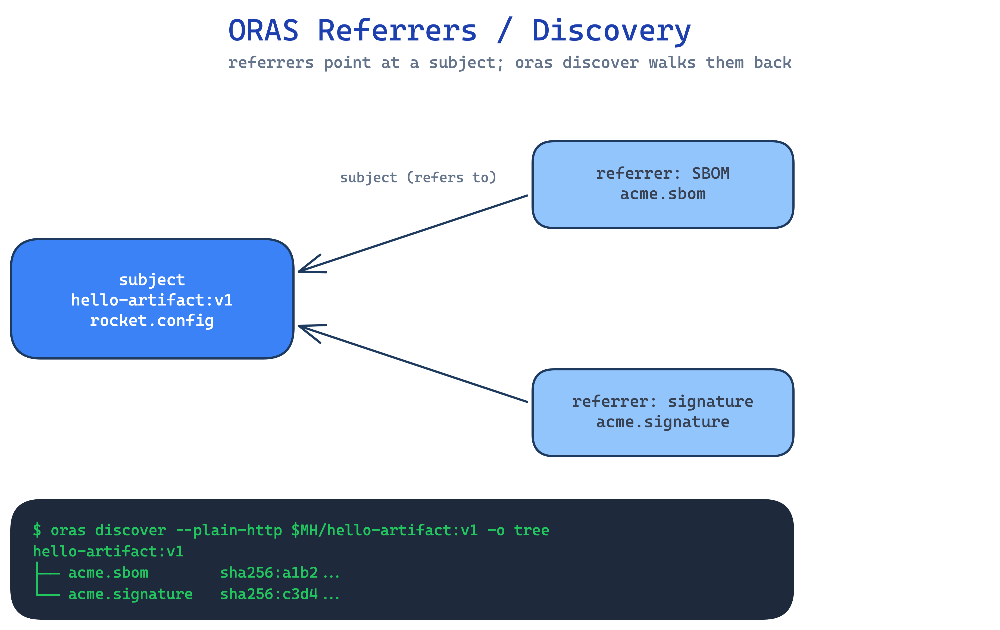

# ORAS Artefacts

MetaHub speaks the OCI artefact + referrers API, so you can push arbitrary
artefacts with [`oras`](https://oras.land/) and discover them via the referrers
endpoint.

## Push a demo artefact

This is the exact flow the deploy pipeline runs (`hello-artifact:v1`):

```bash
# Log in to the MetaHub registry surface
oras login --plain-http -u "${OCI_USERNAME}" -p "${OCI_PASSWORD}" "${MH_HOST}"

# Create a tiny payload
echo "hello world" > artifact.txt

# Push it with a custom artifact type
oras push --plain-http "${MH_HOST}/hello-artifact:v1" \
  --artifact-type "application/vnd.acme.rocket.config" \
  ./artifact.txt
```

Verify the stored `artifactType`:

```bash
oras manifest fetch --plain-http "${MH_HOST}/hello-artifact:v1" --pretty \
  | jq -r .artifactType
# -> application/vnd.acme.rocket.config
```

## Referrers / discovery

Attach a referrer (e.g. a signature or SBOM) to an existing subject and then
discover it:

```bash
# Attach an artefact that references the subject
oras attach --plain-http "${MH_HOST}/hello-artifact:v1" \
  --artifact-type "application/vnd.acme.sbom" \
  ./sbom.json

# Discover referrers of the subject
oras discover --plain-http "${MH_HOST}/hello-artifact:v1" -o tree
```

## In the UI

The frontend surfaces artefacts under `/oras`:

- `/oras` — the artefact listing.
- `/oras/artifact` — artefact detail (artifact type, layers, referrers).

## Diagram



_Source: `docs/assets/diagrams/oras-referrers.excalidraw` (edit + re-render to update)._
