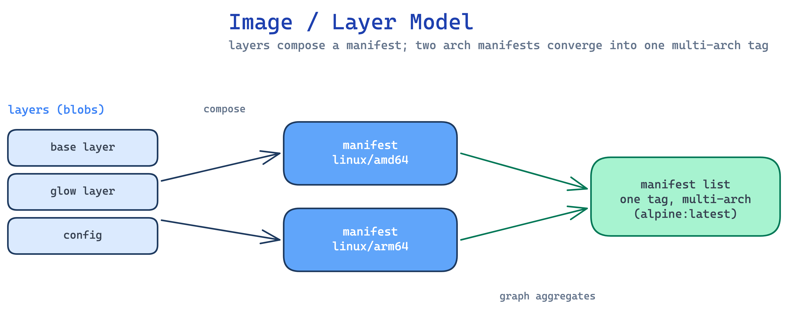

# Small Images

MetaHub works with a deliberately small image set so every layer is easy to
follow. Two families illustrate the core ideas:

- **Glow layers** — tiny single-purpose layers that show layer composition.
- **Multi-arch alpine** — a small base that demonstrates index aggregation
  (`amd64` + `arm64` under one tag).

## What you see

| Concept | Where it shows up |
|---|---|
| Individual layers | **Collections**, expand a manifest row |
| Manifest (single arch) | manifest detail, with config + layers inline |
| Manifest list (multi-arch) | one tag resolving to `amd64` / `arm64` |
| Content size | shown per manifest (the real blob size) |

## Diagram

_Source: `docs/assets/diagrams/image-layer-model.excalidraw` (edit + re-render to update)._
