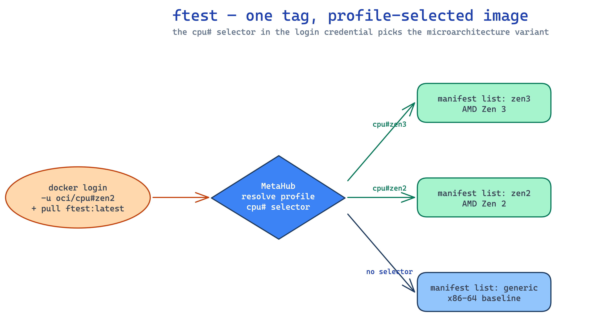

# Small Images

The **featuretest** image (`qnib/ftest`) is a tiny image that prints which CPU
microarchitecture it was built for. It's the easiest way to *see* MetaHub pick
the best-suited image for you: pull the same tag and you get a different image
depending on the profile you logged in with.

## The profile comes from your login

MetaHub reads the profile from the credential you log in with. The username
carries the profile selector — for example `meta/cpu#zen2` asks for the **zen2**
microarchitecture:

```{ .console .no-copy }
$ docker login -u 'meta/cpu#zen2' -p hub {{ registry }}
Login Succeeded

$ docker run --pull=always --platform=linux/amd64 -ti --rm \
    {{ registry }}/qnib/ftest:latest
latest: Pulling from qnib/ftest
Digest: sha256:efdbcb14a0ea770a1b797d2c6aa3d5e753ddc25cf3b8bfddf45e1a3bd6f4cc8b
Status: Downloaded newer image for {{ registry }}/qnib/ftest:latest
>> This container is optimized for the microarchitecture 'zen2'
```

The same `:latest` tag, pulled with a different login, returns a different
`Digest` and a different optimised binary.

## MetaHub filters the manifest list

The trick is that MetaHub rewrites the **manifest list** (the OCI image index)
based on your profile, then Docker's normal platform matching does the rest.

**No profile** — the index contains the full multi-arch set (`arm64` + `amd64`):

```{ .console .no-copy }
$ manifest-tool inspect {{ registry }}/qnib/ftest:latest
Digest: sha256:0a246bae83a800a774d051131334f842f8b72af2ccfe204b21afa4b3de9164ee
 * Contains 2 manifest references (2 images, 0 attestation):
[1] Platform:  OS: linux  Arch: arm64
[2] Platform:  OS: linux  Arch: amd64
```

**With `cpu#zen2`** — the index is filtered to the single zen2-optimised
manifest, so the same tag now resolves to a different image index digest:

```{ .console .no-copy }
$ docker login -u 'meta/cpu#zen2' -p hub {{ registry }}
$ manifest-tool inspect {{ registry }}/qnib/ftest:latest
Digest: sha256:efdbcb14a0ea770a1b797d2c6aa3d5e753ddc25cf3b8bfddf45e1a3bd6f4cc8b
 * Contains 1 manifest references (1 image, 0 attestation):
[1] Platform:  OS: linux  Arch: amd64
```

That `efdbcb14…` index digest is exactly what `docker pull` reported above —
the zen2 build, served because the login asked for it.

## One tag, different images

Log in with a different selector and the filtered index (and therefore the
image you run) changes accordingly:

```{ .console .no-copy }
# cpu#zen3 -> Zen 3 optimised image
$ docker login -u 'meta/cpu#zen3' -p hub {{ registry }}
$ docker run --pull=always --rm {{ registry }}/qnib/ftest:latest
>> This container is optimized for the microarchitecture 'zen3'

# cpu#zen2 -> Zen 2 optimised image
$ docker login -u 'meta/cpu#zen2' -p hub {{ registry }}
$ docker run --pull=always --rm {{ registry }}/qnib/ftest:latest
>> This container is optimized for the microarchitecture 'zen2'

# no microarchitecture selector -> generic baseline
$ docker login -u 'meta' -p hub {{ registry }}
$ docker run --pull=always --rm {{ registry }}/qnib/ftest:latest
>> This container is optimized for the microarchitecture 'generic'
```

Same registry, same `:latest` tag, three different images — that's MetaHub
selecting the best-suited manifest list for the profile.

## The variants

| Login selector | Variant served | Built for |
|---|---|---|
| `meta/cpu#zen3` | `zen3` | AMD Zen 3 cores |
| `meta/cpu#zen2` | `zen2` | AMD Zen 2 cores |
| `meta` (no selector) | `generic` | any `x86-64` baseline — the safe fallback |

Each variant is its own manifest list behind the shared `:latest` tag.

## What you see in the UI

| Concept | Where it shows up |
|---|---|
| The `ftest` tag and its variants | **Collections**, browse to `qnib/ftest` |
| Per-variant manifest lists | each variant (`zen3` / `zen2` / `generic`) as its own list |
| Individual layers | expand a manifest row to see config + layers inline |
| Content size | shown per manifest (the real blob size) |

## Diagram



_Source: `docs/assets/diagrams/ftest-microarch-resolution.excalidraw` (edit + re-render to update)._
