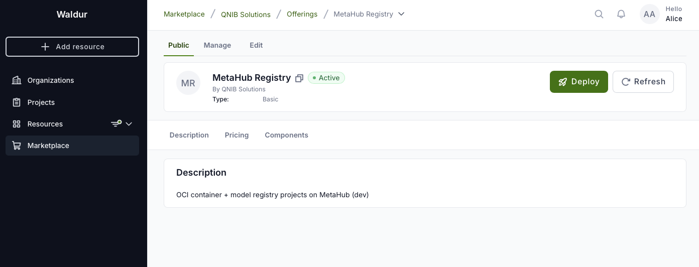
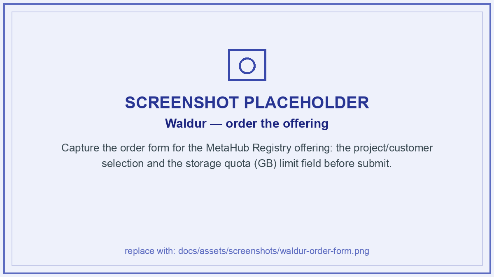
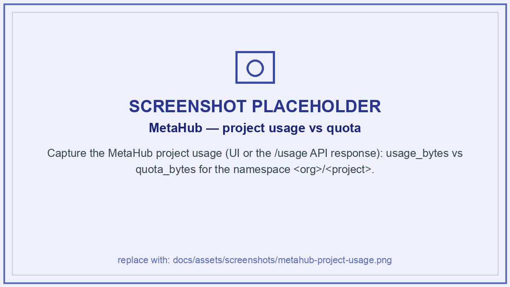
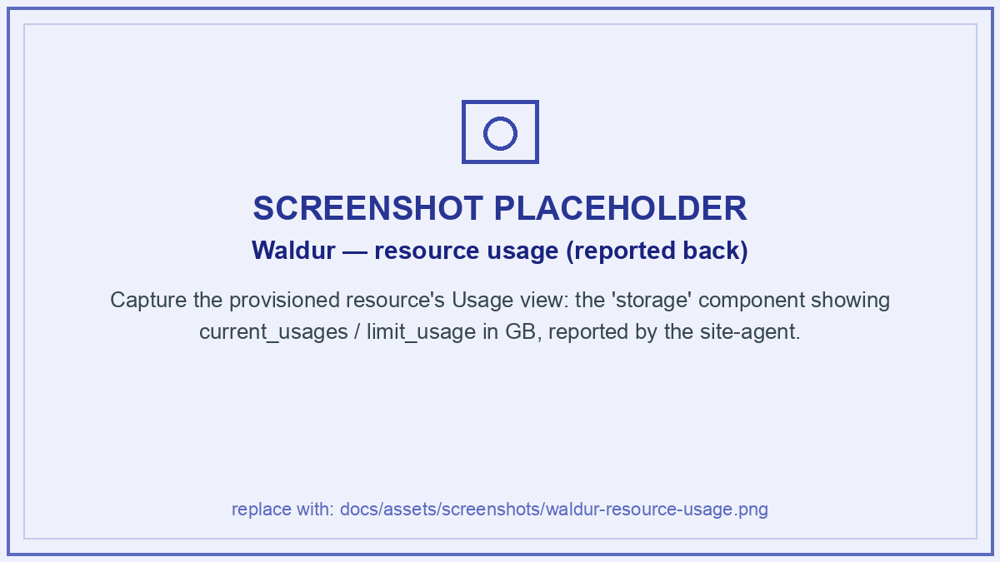
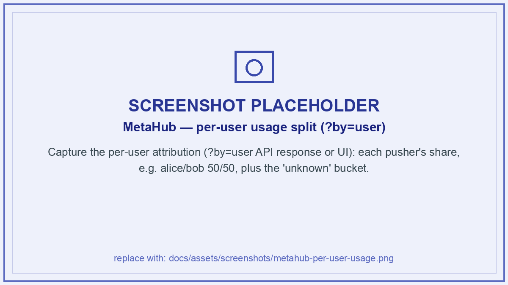

# Waldur Integration

MetaHub plugs into [Waldur](https://waldur.com/) as a **self-service registry
offering**: a user orders a *MetaHub Registry Project* from the Waldur marketplace
and gets a ready-to-use, quota-bounded namespace on the shared MetaHub instance —
no tickets, no manual registry admin.

There is **one shared MetaHub** (one engine, one graph, one content-addressed blob
store with global dedup). A Waldur project does **not** get its own registry; it
configures a **namespace prefix + a storage quota + an access policy** on the shared
instance. The mapping is by construction:

| Waldur | → | MetaHub |
|---|---|---|
| Customer `customer-slug` | → | namespace org segment `<org>` |
| Project `project-slug` | → | namespace `<org>/<project>` (the MetaHub project) |
| Order limit `storage` (GB) | → | project `quota_bytes` (1 GB = 1 GiB) |
| Project members (SSO) | → | Authentik groups → pull/push authorization |



## The lifecycle loop

The [site-agent](#automation-the-site-agent) automates a small, well-defined loop
between Waldur, MetaHub and Authentik:

| Mode | Trigger | What happens |
|---|---|---|
| **order_process** | a create/update/terminate order | upsert the MetaHub project `<org>/<project>` with the ordered quota + visibility; delete on terminate |
| **report** | periodic | read MetaHub usage and post it as the Waldur `storage` component usage |
| **membership_sync** | project membership change | reconcile project members into the namespace's Authentik groups (add **and** remove) |

## 1. Order → provision

Ordering the offering sets the **storage quota** (in GB). On approval the site-agent
provisions the namespace and applies the quota — idempotently, so a repeat order for
an already-provisioned namespace just re-asserts quota/visibility rather than minting
a second namespace (≤ 1 registry namespace per Waldur project).


_Placeholder — replace with a screenshot (`docs/assets/screenshots/waldur-order-form.png`)._

Under the hood the agent calls the MetaHub admin API:

```sh
POST /api/v1/protected/projects
{ "team_slug": "<org>", "project_slug": "<project>", "quota_bytes": <GiB×2^30> }
```

## 2. Push & pull

Users authenticate to the registry with their **Authentik** identity (OIDC) and push
or pull under the namespace like any OCI registry:

```sh
docker login <registry> -u <user> -p <app-password>
docker push  <registry>/<org>/<project>/<image>:<tag>
```

Reads and writes are authorized against the project's Authentik groups; the storage
consumed counts against the project quota.

!!! note "Logical, deduplicated storage"
    Blobs are stored **once** globally (content-addressed). A project's usage is the
    sum of the **distinct** blob sizes reachable from its manifests — so a project is
    charged fully for what it references, while identical bytes shared across projects
    are physically stored a single time.

## 3. Quota & usage

Each project has a `quota_bytes` budget; a push that would take the project's logical
usage over quota is **rejected**. Current usage is read from the admin API:

```sh
GET /api/v1/protected/projects/<org>/<project>/usage
→ { "usage_bytes": 4092947, "quota_bytes": 107374182400 }
```


_Placeholder — replace with a screenshot (`docs/assets/screenshots/metahub-project-usage.png`)._

The `report` mode converts usage bytes → GB (2 decimals) and posts it to Waldur, where
it appears on the resource as `current_usages` / `limit_usage` for the `storage`
component — closing the accounting loop.


_Placeholder — replace with a screenshot (`docs/assets/screenshots/waldur-resource-usage.png`)._

## 4. Per-user usage attribution

Beyond the project total, MetaHub attributes usage to the **individual pushers**,
de-duplicated **at push**. Each blob's size is split equally among the distinct users
who pushed a manifest referencing it. If Alice pushes a 500 MB image and Bob later
pushes the same image, the project total grows by 500 MB **once**, and each user is
charged **250 MB**.

```sh
GET /api/v1/protected/projects/<org>/<project>/usage?by=user
→ { "usages": { "alice": 1815466.5, "bob": 1815466.5 }, "quota_bytes": 1073741824 }
```


_Placeholder — replace with a screenshot (`docs/assets/screenshots/metahub-per-user-usage.png`)._

!!! info "Reconciliation & the `unknown` bucket"
    The sum of the per-user shares plus a reserved `unknown` bucket always equals the
    project total. `unknown` holds bytes with no attributable pusher — compute-generated
    artefacts (model repackaging/injection) or pushes recorded before per-user tracking.
    The site-agent reports the real users to Waldur and drops `unknown` (that remainder
    stays implicit in the account total).

## Automation: the site-agent

A dedicated `waldur-site-agent` backend (`metahub`) runs the loop above on a schedule:
`order_process` (provision + quota + visibility), `report` (usage → Waldur, including
the per-user breakdown), and `membership_sync` (Waldur members → Authentik groups).
MetaHub itself needs nothing extra for membership — it reads the `groups` claim from
the OIDC token; the agent owns group lifecycle in Authentik.
