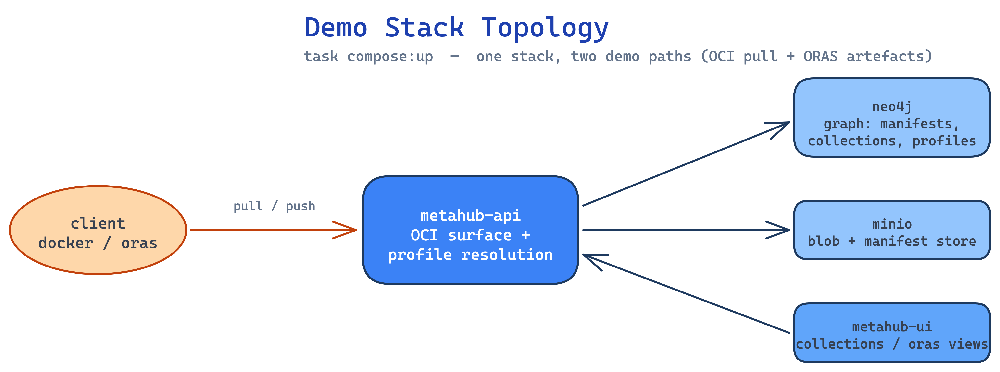

# Walkthrough

The end-to-end live demo script. Run from the metahub-api repo unless noted.

## 0. Bring up the stack

```bash
task compose:up
```

Open the UI at the compose-exposed URL and confirm the landing page renders.

## 1. Seed the small image set

```bash
task compose:seed:glow
task compose:multi-alpine
task compose:seed:graph
```

Show `/collections` — expand a manifest row to reveal config, annotations and
layers inline. See **[Small Images](small-images.md)**.

## 2. Show profile-aware resolution

- Open `/profiles` and pick a profile.
- Open `/profiles/:label` and show the **Manipulations** section (default +
  variants). See **[Manipulations](manipulations.md)**.
- Pull a tag with and without the profile context; diff the manifests.

## 3. OCI pull path

```bash
# Resolve a multi-arch tag — one tag, two architectures
docker pull "${MH_HOST}/<repo>:<tag>"
```

Point out index aggregation: the single tag resolves to `amd64`/`arm64`.

## 4. ORAS artefact + referrers

```bash
oras push --plain-http "${MH_HOST}/hello-artifact:v1" \
  --artifact-type "application/vnd.acme.rocket.config" ./artifact.txt
oras discover --plain-http "${MH_HOST}/hello-artifact:v1" -o tree
```

Show the same artefact in the UI under `/oras`. See
**[ORAS Artefacts](oras-artefacts.md)**.

## 5. Tear down

```bash
task compose:down
```

## Diagram



_Source: `docs/assets/diagrams/demo-stack-topology.excalidraw` (edit + re-render to update)._
