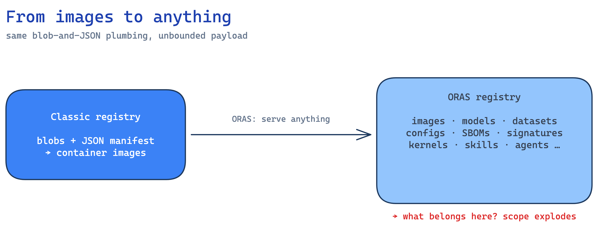
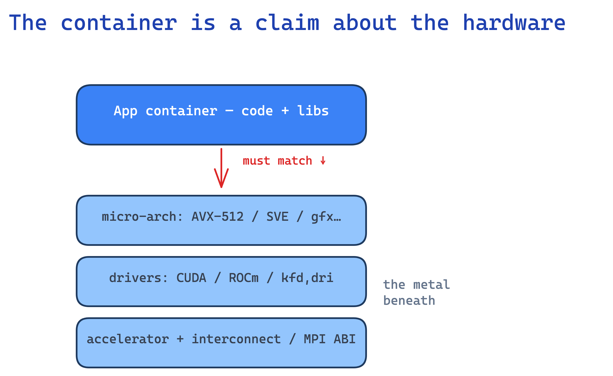
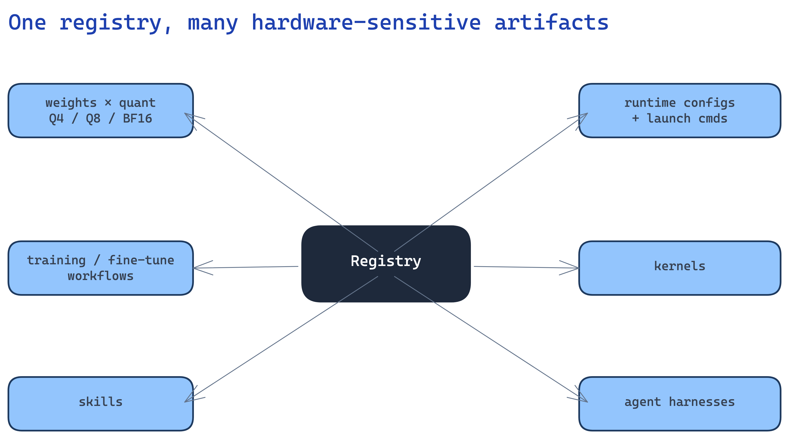
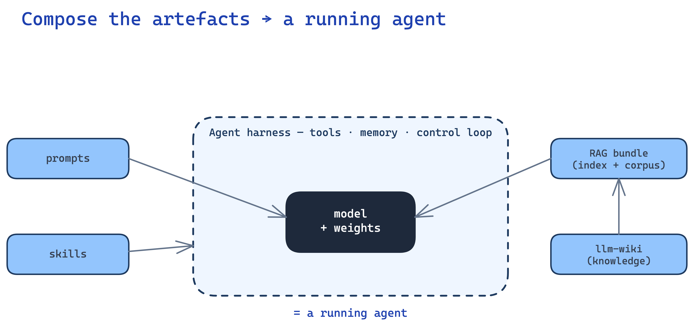
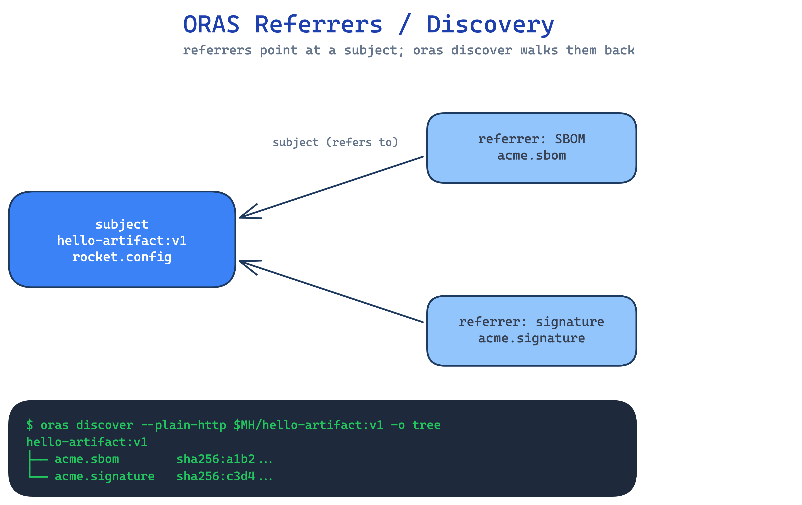
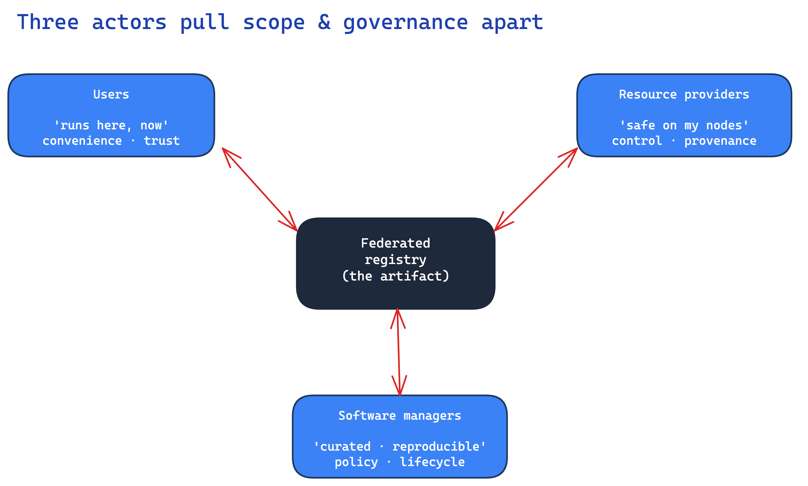
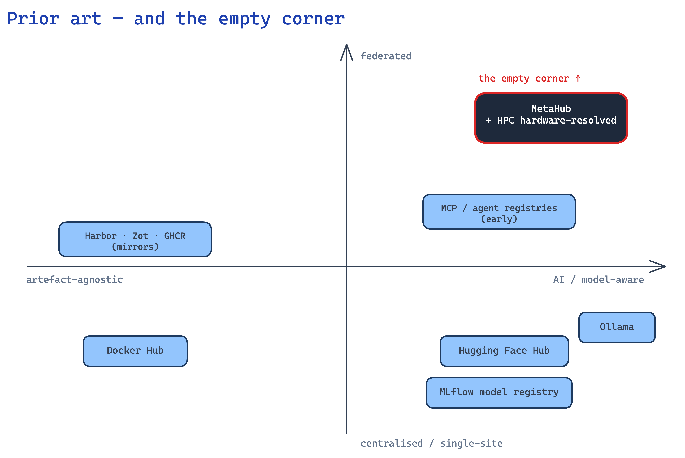
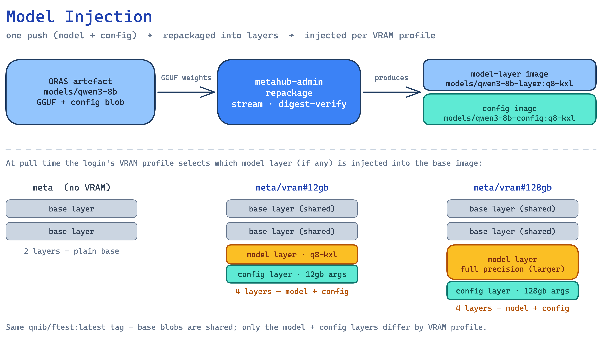

<!--
Presenter: Christian Kniep · QNIB Solutions
Slot: 30 min keynote — opens the workshop discussion (~22 min talk + ~8 discussion)
This is the Marp flow-draft (source of truth).

Diagrams: early Excalidraw sources live in metahub-docs/docs/assets/diagrams/
(keynote-*.excalidraw). Render them to sibling PNGs before export:
  misc/diagrams/render-all.sh keynote-registry-evolution keynote-hpc-coupling \
      keynote-artifact-zoo keynote-three-actors

Export to PowerPoint (local images need --allow-local-files):
  marp keynote.md --pptx --allow-local-files -o keynote.pptx
Editable (needs soffice): add --pptx-editable
-->

# What do we federate?

## One opinionated perspective on a registry for AI on HPC

**Christian Kniep** · QNIB Solutions

NFCS AI Container Registry — Workshop 4
University of Cambridge, West Hub (Room A) · 21 July 2026

<!--
Talking points:
- Welcome — thank the organisers; this keynote opens the day and frames the workshop discussion.
- Today is about the *federation* question: actors, governance, implementation.
- My job here is not to give the answer — it's to seed ONE opinionated view,
  concrete enough to argue with, so the workshop discussion has something to push against.
- Housekeeping up front: the feasibility-study user survey closes 17:00 TODAY.
  I'll come back to it on the last slide — please leave time to fill it in.
- One-line promise: by the end you'll see why "what we federate" is really a
  "who governs it" question in disguise.
-->

---

## A registry used to be simple

- Blobs + a JSON manifest
- One job: distribute **container images**
- Content-addressed, cache-friendly, boring — in a good way

<!--
Talking points:
- Set the shared baseline everyone in the room already trusts: push image, pull
  image. A manifest referencing content-addressed blobs. That's it.
- "Boring" is the compliment — determinism, dedup, caching, mirroring all fall
  out of content-addressing for free.
- Hold this picture; the next slide is where it stops being simple.
-->

---

## Then ORAS let it serve *anything*

> Serving anything is exactly the problem.

<!--
Talking points:
- ORAS keeps the SAME blob-and-JSON plumbing but drops the "must be an image"
  assumption — now the registry holds models, datasets, configs, SBOMs,
  signatures, policies, whatever.
- This is genuinely powerful — and exactly the problem: the registry stops
  meaning one thing. "What belongs here?" is suddenly a real question.
- That question — scope — is the through-line of the whole talk. Everything
  after this is a consequence of the registry being able to hold anything.
- (Diagram: classic image-only registry on the left; ORAS "anything" on the
  right; scope explodes.)
-->

---

## Back to the boring part: the container

*and it's not as boring as it seems*

<!--
Talking points:
- Let's get back to the boring part — the container itself. It's not as boring as it looks.
- Every HPC old-schooler already knows this: a single container is NOT optimal for
  everything. You trade portability against micro-arch / driver / interconnect
  optimization. That was true for MPI + BLAS; it's just as true in AI land.
- The common move today: push a big runtime with an all-encompassing CUDA "knapsack" —
  one fat image that carries the whole toolkit and hopes to run everywhere.
- What makes that actually work is libcuda injection: the container ships the CUDA
  runtime but relies on the *host* driver's libcuda being injected at run time, and on
  it staying upwards/forward compatible. NVIDIA did a genuinely great job here — that
  ABI stability is why one fat CUDA image survives across driver versions and nodes.
- But injection only papers over the driver layer. Micro-arch targets, GPU gfx
  (especially ROCm/gfx), and the interconnect / MPI ABI still bind the image to the
  metal. So the container is still a *claim about the hardware* — just a more forgiving
  one on the NVIDIA side.
- Federation therefore still can't ignore placement: what you can pull depends on the
  node you'll run on. Hold that thought for the actors slide.
-->

---

## And the payload keeps growing

*let's explore the zoo — which artefacts matter depends on the use-case and the user cohort*

<!--
Talking points:
- From here on, treat this as an EXPLORATION, not a fixed list. Beyond the app
  container there's a whole "artifact zoo" around a single model:
  - weights across quantizations (Q4 / Q8 / BF16 …)
  - runtime configs & launch commands
  - training / fine-tuning workflows
  - kernels, skills, agent harnesses
- Every one is versioned, hardware-sensitive, and wants its own lifecycle. Weights
  alone fan out across quantizations; multiply by runtimes.
- The point isn't the list — it's the combinatorics. "One model" is really a matrix
  of artifacts, and the registry is now the thing holding that matrix.
- Crucially: WHICH of these matter most is not universal — it depends on the targeted
  use-case and the user cohort. A fine-tuning shop, an inference-serving site, and an
  agent builder each care about very different corners of the zoo.
- Explicit ask / workshop outcome: I want to leave here with MULTIPLE PERSPECTIVES on
  which artefacts we actually need to care about most — that's a takeaway I'm looking
  for from the room today.
-->

---

## The artefacts, briefly

*skills · prompts · agent harness · RAG · llm-wiki — each versioned, runtime-sensitive, with its own lifecycle.*

<!--
Talking points:
- Keep this brief — just enough shared vocabulary so the "zoo" isn't hand-wavy.
- Skills: a loadable unit of "how to do X" — instructions plus optional scripts/resources; composed at runtime.
- Prompts: prompts are assets now — versioned, reviewed, regression-tested; they ship separately from weights.
- Agent harness: the scaffolding around the model — tool wiring, memory, the plan/act loop; code + config, tightly coupled to the runtime.
- RAG bundle: the retrieval side — a built index + the corpus it came from + the query config; large, and it drifts as the corpus changes.
- llm-wiki: curated domain/organisational knowledge used to ground answers — governance-sensitive (who may read it, who may publish).
- Punchline: five artefacts, five different sizes, cadences, and trust needs — exactly why one-size federation fails.
-->

---

## Building blocks group by behaviour

*behaviour — not file type — decides how you federate each one*

| Behaviour → **strategy** | Artefacts |
|---|---|
| **Heavy & static** → mirror / cache | container images · weights & checkpoints · datasets · compiled engines (GGUF · ONNX · TensorRT/ROCm) |
| **Mutable state** → sync | embeddings & vector indices · RAG corpora · agent / session memory |
| **Lightweight & coupled** → version-control | tokenizers & configs · prompts · skills & tools (MCP) · harness & pipelines |
| **Metadata & trust** → index & sign | model cards · lineage / provenance · signatures (cosign) · SBOMs |

<!--
Talking points:
- The payoff of the "zoo": stop sorting artefacts by file type, sort them by BEHAVIOUR — and behaviour picks the federation strategy.
- Heavy & static (images, weights, datasets, compiled engines): big, immutable → mirror / cache. The classic registry job.
- Mutable state (embeddings, RAG corpora, agent memory): changes constantly → sync; often cheaper to rebuild than to ship.
- Lightweight & coupled (tokenizers, prompts, skills/MCP, harness): tiny but must travel WITH the weights → version-control them together.
- Metadata & trust (cards, lineage, signatures, SBOMs): the connective tissue → index & sign; this is what makes provenance travel with the artefact.
- Treat this grouping as ONE lens, not the truth — which cells dominate depends on your cohort. Agreeing where the weight sits is part of today's exploration.
- Source: my ISC 2026 BoF "Towards a federated European AI Hub" — full extraction in research-bof-ai-hub.md.
-->

---

## OCI registry vs. ORAS — the subject link

*plain OCI stores images; ORAS adds a referrers graph — attach SBOMs, signatures & provenance to a subject*

<!--
Talking points:
- Quick mechanism slide — because "index & sign" from the last slide needs somewhere to live.
- A plain OCI registry stores content-addressed blobs + JSON manifests: an image is a manifest pointing at layer blobs. That's it — it doesn't know a model from an SBOM.
- ORAS uses the SAME store, but a manifest can declare a `subject` — "this artefact is ABOUT that one." That builds a referrers graph hanging off a subject digest.
- So an SBOM, a cosign signature, a model card, a provenance attestation each become their own artefact that REFERS to the model manifest — and `oras discover` walks them back.
- Why it matters for federation: provenance & trust travel WITH the artefact as first-class referrers, not in a side database you'd have to federate separately. Pull the model anywhere and discover its SBOM + signatures alongside it.
- This is the concrete plumbing under the "metadata & trust → index & sign" row.
-->

---

## ORAS — the substrate, a little deeper

*one registry, arbitrary artefacts — the OCI plumbing the whole AI zoo rides on*

| ORAS capability | What it gives you |
|---|---|
| **Arbitrary `artifactType`** | a manifest can *be* a model, dataset, RAG index or skill — not just an image |
| **Typed config blob** | structured metadata (model card, launch/runtime config) rides in the manifest |
| **`subject` + referrers** | attach SBOMs, signatures, provenance to any artefact; `oras discover` walks them |
| **`push` · `pull` · `attach` · `cp`** | simple CLI + libraries; `cp` mirrors between any OCI registries |
| **Runs on any OCI registry** | referrers API where available, tag-schema fallback where not |
| **Content-addressed + dedup** | one blob store → mirror- and cache-friendly across sites |

<!--
Talking points:
- The boring-but-powerful substrate: ORAS is *just* OCI — so Harbor, Zot, GHCR, mirrors and the whole registry ecosystem already work. No new protocol to federate.
- artifactType: the manifest declares WHAT it is, so a hub can reason about models vs datasets vs skills instead of "just blobs".
- Typed config blob: metadata rides in the manifest, not a side database you'd federate separately.
- subject + referrers: recap of the last slide — provenance/trust travel WITH the artefact.
- push/pull/attach/cp: dead-simple ops; `oras cp` is literally how you mirror/federate between registries.
- Runs anywhere: no special server; graceful fallback for older registries.
- Content-addressed dedup: exactly the mirror/cache property HPC federation needs.
- Punchline: we don't need to invent a distribution protocol — the AI zoo rides on OCI/ORAS we already trust.
-->

---

<!-- _class: lead -->

# *What* we federate
# is inseparable from *who* it serves

<!--
Talking points:
- The pivot of the talk. Say it plainly: you cannot decide what belongs in a
  federated registry without first asking who it's for.
- Scope looks like a technical question (which artifacts, which formats) but it
  resolves differently depending on whose needs you optimise for.
- So "what do we federate?" is a governance question wearing an engineering hat.
- Next: the three constituencies, and how each answers it differently.
-->

---

## Three actors, three directions

<!--
Talking points — walk each actor pulling the same artifact a different way:
- Users: "give me a model that runs here, right now." Pull toward broad scope +
  convenience; trust-by-default. They want the matrix flattened for them.
- Resource providers: "only what's safe on MY nodes." Pull toward narrow scope +
  control — provenance, quotas, what's allowed to execute on their hardware.
- Software managers: "curated, reproducible, supported." Pull toward policy,
  versioning, lifecycle — the long-term maintainability view.
- Same artifact, three incompatible asks. Federation is precisely the place
  where these three negotiate — that negotiation IS the governance model.
- (On-screen: the three actors pulling the central artifact in different
  directions; the tension is the message.)
-->

---

## Who is the hub for? — user bases

*the same registry, very different cohorts — each cares about a different corner of the zoo*

| Cohort | Pulls / pushes | Cares most about |
|---|---|---|
| **Inference / serving sites** | a model + quant that fits the node | right-artefact resolution, speed |
| **Fine-tuning / training shops** | base weights + datasets + recipes; push fine-tunes | reproducibility, lineage |
| **Agent builders** | compose skills, prompts, harness, RAG | versioning, runtime coupling |
| **Resource providers (HPC centres)** | mirror / cache; gate what runs | provenance, attestation, quotas |
| **Software managers / curators** | curate, sign, deprecate | policy, lifecycle |
| **Researchers** | reproduce & cite results | provenance, signatures |

<!--
Talking points:
- The concrete answer to the "who" from the pivot — the same registry serves wildly different cohorts.
- Top three map to "users", bottom two to providers/managers (the actors slide); researchers straddle.
- Walk a couple: a serving site wants the ONE image that fits its GPU; a training shop wants weights + datasets + the recipe and to push adapters back.
- The exploration ask: which cohorts matter most for OUR hub, and which artefacts each really needs — that's what I want the room's perspectives on.
-->

---

## What it unlocks — use-cases

- **Model-centric pull** — ask for a model + quant, get the image that fits *this* GPU
- **Trust-gated execution** — verify SBOM + signature (ORAS referrers) before a node runs it
- **Cross-site datasets + recipes** — federate the canonical sources, reproduce derived artefacts locally
- **Shared RAG corpora & embeddings** — sync the mutable knowledge layer across sites
- **Federated agent skills & tools (MCP)** — distribute and version skills, prompts, harness
- **Reproducible distillation / fine-tuning** — recipe + weights in, a verifiable model out

<!--
Talking points:
- Concrete scenarios the hub enables — grounding before I show one implementation.
- Model-centric pull is the headline UX; trust-gated execution is the providers' veto via ORAS referrers.
- Datasets + recipes = the federate-vs-reproduce cut; RAG = the mutable "sync" layer; MCP skills = lightweight-coupled.
- Each maps back to an artefact behaviour and a cohort — which is why "which artefacts?" is the question I keep coming back to.
- Bridge: MetaHub is one opinionated implementation of these →
-->

---

## Prior art — nobody covers all of it

**Gap:** none unify hardware-resolved pull + the full artefact zoo + federated, actor-aware governance for HPC.

<!--
Talking points:
- Credit first — none of this is greenfield; each tool is good at its slice.
- Hugging Face / Ollama: great model-hub UX, but they assume you already know which file you want; the HPC hardware-resolution and container coupling from slide 4 aren't their job.
- Harbor / Zot / Docker Hub / GHCR: rock-solid OCI/ORAS distribution — but artefact-agnostic; they don't know a model from a mascot, and governance is per-repo, not per-actor.
- MCP / agent registries: exciting but young — mostly tool/agent discovery, little on federation, provenance, or trust.
- MLflow / model registries: strong on lifecycle and stages, but they're catalogues, not the thing that ships bytes to a node.
- The gap is the *union*: hardware-resolved pull + the whole artefact zoo + federated governance that respects the three actors. That union is where MetaHub plants its flag →
-->

---

## MetaHub — one opinionated take

- **Model-centric pull** — ask for a model + quant, get the image that fits *this* node
- **Manipulation / injection** — compose runtime + config + weights at push/compute time
- **Profile-scoped governance** — who sees what, who may write

<!--
Talking points:
- Not "the answer" — a worked example of *taking a position* on the three
  tensions from the last slide:
  - Resolve to the hardware (model-centric pull) → serves the user without
    lying about portability.
  - Compose artifacts server-side (injection) → the matrix is assembled, not
    dumped on the user.
  - Scope by profile → providers/managers get the governance lever.
- Walk the injection diagram briefly: model + runtime + config composed into the
  image that lands on the node.
- Frame it as a starting position for the workshop, not a product pitch — "here's
  one set of choices; the room will have others."
-->

---

## Seeds for the workshop discussion

- **Boundary** — what belongs in a *federated* registry vs. a local one?
- **Ownership** — who governs: providers, managers, or a federation body?
- **Trust** — what must be signed / attested before it runs on my nodes?
- **Scope** — do we federate the artifacts, or just *pointers* to them?
- **Which artefacts?** — of the whole zoo, which matter most for *your* use-case & user cohort?

<!--
Talking points:
- Put these to the room deliberately unresolved — they map back to the actors:
  - "Which artefacts?" is the takeaway I most want: multiple perspectives on the zoo.
  - Boundary & Scope are the "users vs providers" tension.
  - Ownership is the "who holds the governance lever" question.
  - Trust is the providers' veto: attestation/signing before execution.
- Invite disagreement with the MetaHub position — that's the point of seeding one.
- Bridge to the survey: "if you have a view on any of these, the survey is where
  it counts."
-->

---

<!-- _class: lead -->

# Have your say

**The feasibility-study user survey closes today — 17:00.**

Shape what an AI container registry should be — and win vouchers for your time.

`[ QR CODE ]`

https://nfcs-networkplus.ac.uk/projects/federated-ai-application-container-platform/

<!--
Talking points:
- The single ask of the talk: fill in the survey before 17:00 today — it closes
  during this workshop.
- It feeds the feasibility study directly; this is the moment to have your say on
  what an AI container registry should be.
- Incentive: vouchers for your time.
- Insert the REAL survey QR/short-link before the talk (placeholder here).
- Thank you — open the floor for the workshop discussion.
-->
